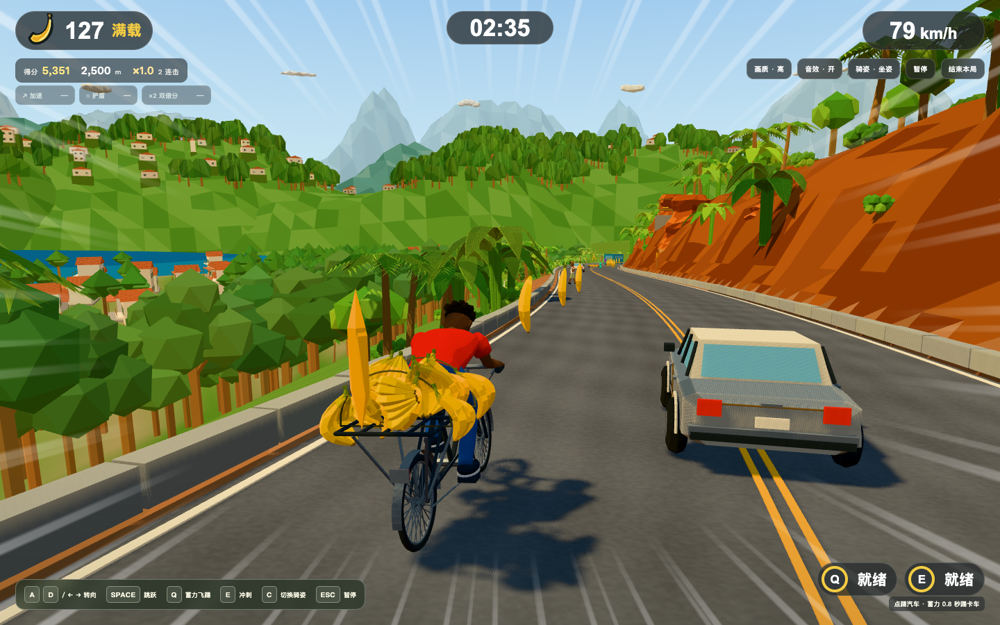

# 彪速骑行 · 无尽香蕉山道

Blender + Three.js 的低多边形无尽骑行原型。按图 A 的方向制作人物、二八大杠、香蕉、热带山道和飞踢卡车；开局空货架，自动前进，沿路拾取。整体画面还没有达到图 A 的严格还原。

最新修复及验证范围见 [改进结果](docs/NEXT-STEPS-RESULTS.md)，剩余事项见 [卡点报告](docs/BLOCKERS.md)。[图 A 与实现草稿索引](assets/reference/README.md) 保留已确认与未确认状态。



## 运行

需要 Node 24+、pnpm。仓库包含全部运行模型，直接玩无需安装 Blender。

```sh
pnpm install --frozen-lockfile
pnpm dev
```

开发入口为 http://127.0.0.1:5173/ 。生产预览：

```sh
pnpm build
pnpm preview --port 4173 --host 127.0.0.1
```

生产构建生成 Brotli/gzip 文件；内置 Node 服务按浏览器能力返回压缩资源。外部托管需采用同等配置，示例见 [Nginx 配置](deploy/nginx.conf)。

## 玩法

| 输入 | 行为 |
|---|---|
| 开始 / Enter | 3秒倒计时，开始自动骑行 |
| A/D / 左右箭头 | 连续横移，有惯性，不锁轨 |
| Space | 跳跃 |
| Q 按住后松开 | 蓄力0.8秒踢重卡；汽车可点踢；冷却18秒 |
| E | 冲刺1.5秒、速度×1.25、冷却6秒 |
| C / 骑姿按钮 | 默认坐姿；切换一脚踩车把、一脚踩车座的站姿特技 |
| Esc / 暂停 | 暂停、继续；后台/失焦也暂停 |
| 结束本局 | 主动结算；碰撞失败也结算 |
| 竖屏按钮 | 连续左右、跳跃、冲刺、蓄力踢击 |

基础速度12m/s，每250m增加1m/s，上限26m/s。加速道具5秒，护盾8秒挡一次碰撞，双倍分10秒；同种刷新、不同种共存。

每米1分、每蕉10分、成功跳障50分、踢重卡/汽车200/100分。2.5秒内连续奖励延续连击，每5次增加0.2倍、最多2倍；双倍作用于全部得分，连击作用于奖励。本机纪录保存在 localStorage。

货架最多显示100根，拾取数和得分仍无上限。无装货环节、终点、通关门槛或手动控速。完整流程、碰撞规则和原逻辑清单见 [无尽规格](docs/endless-design.md)。

## 原生资产与动作

所有可见三维网格由本地 Blender 5.2.2 LTS 建模并保存源文件；运行时没有用 Three.js 基础几何替代游戏模型。

| 源文件 | 内容 |
|---|---|
| `assets/blender/asset-library.blend` | 自行车、四种蕉束、20束货堆、16部件卡车、障碍、道具、植被与特效 |
| `assets/blender/rider-hero.blend` | 独立新角色、Rigify控制、加权蒙皮、16个Action/NLA与对象关节回退 |
| `assets/blender/endless-course.blend` | 20段80m原生弯路、标线、护栏和路侧摆放 |
| `assets/blender/standing-motion.blend` | 同场自行车、接触点与历史对象动作时间轴 |
| `assets/blender/valley-layout.blend` | 海岸城镇、水面、三个景深带、山云变体及森林LOD |
| `assets/blender/rock-kit.blend` | 六种封底红岩模块 |
| `assets/blender/mountain-course.blend` | 保留的历史配送路线 |

角色10896三角面、5912顶点、15根变形骨、每顶点最多2个权重。Rigify使用定制 `basic.super_copy` 控制骨，烘到变形骨，并非直接使用完整 Human 模板。默认播放蒙皮GLB；`?rig=legacy` 可对照对象回退。AnimationMixer控制动作，运行时接触IK保证手握把、脚踏板和站姿支撑；暂停冻结，重开恢复坐姿。准备页有Idle，碰撞后继续播放有限失败动作。

16个片段包括准备、坐/站、双向切换、起跳/腾空/落地、双侧蓄力/踢击、双侧倾斜、护盾受击及失败；建议正文“14个”与表格不一致，本轮按表格16个交付。

规范GLB在 `assets/export/`；无损Meshopt生成 `public/assets/`。60模型规范体积20.30MB、运行体积约12.29MB；逐缓冲校验颜色、矩阵、extras、动画、权重、图片与顶点顺序。只对天空导出三角列表作确定性排序，保留全部带绕序三角形。

```sh
/Applications/Blender.app/Contents/MacOS/Blender --background --factory-startup --python-exit-code 1 --python scripts/test-blender.py
pnpm assets:fingerprint
pnpm assets:compress
pnpm check:assets
pnpm build
```

`test-blender.py` 会全量重建；其他 `scripts/test-*.py` 校验已保存原生源。修改资产后确认有意差异才执行 `pnpm assets:fingerprint:update`；不能用更新指纹掩盖意外漂移。

## Three.js 与性能

GLTFLoader注册MeshoptDecoder；SkeletonUtils独立克隆蒙皮角色。四种蕉束、植被、远山和粒子用InstancedMesh；近树172面、远树LOD1为32面、远景LOD2为12面。低档两份滚动场景均保留45%森林密度，近岸树使用LOD1、远岸树使用LOD2。

60Hz固定规则、扫掠碰撞和自由横移保持不变。Rapier接收实际Blender路面，驱动踢车与最多12个、寿命3秒的表现零件；回收卡车恢复门/尾板/箱子，旧零件不影响复用后的模型。它们不参与积分判定。

三层Toon明暗、暖光、顶点AO、雾、动态阴影、速度线和速度FOV。背景/前景两次渲染；发光面片采用加法混合，不增加Bloom全屏通道。竖屏踢击回撤同时保持侧角，人、车、货架与两轮轮廓都校验；减少动态效果和暂停设置生效。

25个免费音频样本共约253KB，首次交互后加载、缓存，同类最多4声部；缺样本回退合成。风和链声循环跟速度变化，暂停/后台/重开清理；结算与碰撞尾音自然结束。[逐文件来源与CC0授权](public/audio/LICENSES.md)。

## 验证与发布边界

```sh
pnpm test
pnpm typecheck
pnpm check:assets
pnpm check:compressed
pnpm assets:fingerprint
pnpm build
GAME_URL=http://127.0.0.1:4173/ pnpm smoke
```

浏览器QA需另装Playwright；设置 `PLAYWRIGHT_MODULE` 可使用已有ESM入口。冒烟支持 `PLAYWRIGHT_BROWSER=chromium|firefox|webkit`；Chromium默认Chrome，空 `PLAYWRIGHT_CHANNEL` 使用安装的Playwright Chromium。Firefox/WebKit无WebGL2时报告明确跳过，不冒称兼容通过。竖屏Chromium检查实际持续触控。

完整玩法、HUD/输入、WebGL恢复、路面周期、动态货物和角色投影分别使用 `browser-check.mjs`、`fidelity-check.mjs`、`context-check.mjs`、`valley-check.mjs`、`cargo-clearance-check.mjs`、`hero-check.mjs`、`kick-camera-check.mjs`。注入100蕉、距离或盾的夹具都单独标注，不能当玩家成绩或真机性能。

```sh
HEADED=1 GAME_URL=http://127.0.0.1:4173/ PERF_SECONDS=60 PERF_REPEATS=3 PERF_SIZE=1920x1080 pnpm perf
```

测速统计整个真实rAF采样窗口及全部GL绘制/阴影通道；不滤掉长帧。盾仅用于让测速跑局持续。实际Apple M6结果不代替GTX1650/IrisXe或手机验收，[真机清单](docs/device-checklist.md) 记录仍待测的设备。

CI固定Node24、Playwright和Blender5.2.2下载校验和。原生重建固定在macOS ARM64，与本地资产作者平台一致，执行原生检查、严格指纹及无损压缩；Linux执行游戏构建和三个浏览器冒烟。首轮Linux x64重建实际发现32个赛道朝向尾数及23个GLB的浮点/排列差异，因此不宣称跨平台字节一致，也不放宽指纹或改写原路面基线。不会自动提交重建资产。完整光照烘焙贴图、KTX2、后期Bloom、完整轮胎物理和在线排行暂未实现；整体图A构图与正式真机验收仍在改进结果中单列。
