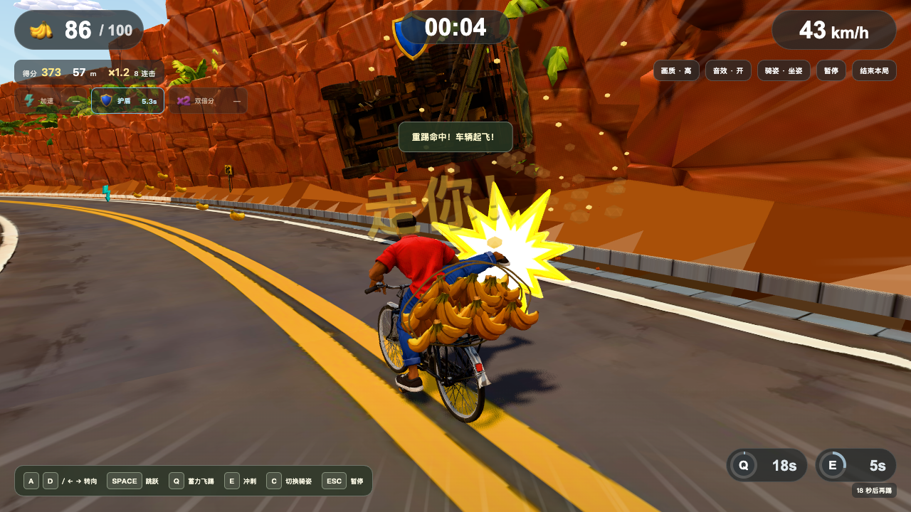

# 彪速骑行 · 无尽香蕉山道

Tripo H3.1 资产、本地 Blender 精修与动作、Three.js 展示的无尽骑行游戏。红衫骑手驾驶二八大杠，沿热带山道自动前进、拾取香蕉、跳跃避障和蓄力踢飞卡车。美术以图 A 为基准；实际截图与验证范围见本轮报告。

最新架构、玩法、关卡与性能复审见 [技能复审报告](docs/banana-reaudit-20261028.md)；模型和动作制作证据见 [资产重制报告](docs/banana-audit-20261028.md)，剩余事项见 [卡点报告](docs/BLOCKERS.md)。[图 A 与实现草稿索引](assets/reference/README.md) 保留已确认与未确认状态。



## 运行

需要 Node 24+、pnpm。仓库包含全部运行模型，直接玩无需安装 Blender。

```sh
pnpm install --frozen-lockfile
pnpm dev
```

开发入口为 http://127.0.0.1:5173/ 。生产预览：

```sh
pnpm build
pnpm preview --port 4173 --host 127.0.0.1
```

生产构建生成 Brotli/gzip 文件；内置 Node 服务按浏览器能力返回压缩资源。外部托管需采用同等配置，示例见 [Nginx 配置](deploy/nginx.conf)。

## 玩法

| 输入 | 行为 |
|---|---|
| 开始 / Enter | 3秒倒计时，开始自动骑行 |
| A/D / 左右箭头 | 连续横移，有惯性，不锁轨 |
| Space | 跳跃 |
| Q 按住后松开 | 蓄力0.8秒踢重卡；汽车可点踢；冷却18秒 |
| E | 冲刺1.5秒、速度×1.25、冷却6秒 |
| C / 骑姿按钮 | 默认坐姿；切换一脚踩车把、一脚踩车座的站姿特技 |
| Esc / 暂停 | 暂停、继续；后台/失焦也暂停 |
| 结束本局 | 主动结算；碰撞失败也结算 |
| 竖屏按钮 | 连续左右、跳跃、冲刺、蓄力踢击 |

基础速度12m/s，每250m增加1m/s，上限26m/s。加速道具5秒，护盾8秒挡一次碰撞，双倍分10秒；同种刷新、不同种共存。

每米1分、每蕉10分、成功跳障50分、踢重卡/汽车200/100分。2.5秒内连续奖励延续连击，每5次增加0.2倍、最多2倍；双倍作用于全部得分，连击作用于奖励。本机纪录保存在 localStorage。

货架最多显示100根，拾取数和得分仍无上限。无装货环节、终点、通关门槛或手动控速。完整流程、碰撞规则和原逻辑清单见 [无尽规格](docs/endless-design.md)。

## 原生资产与动作

辨识性模型来自同一批 **29 类 Tripo H3.1 母版**，由本地 Blender 5.2.2 LTS 统一尺寸、材质、分件、骨骼、动作和LOD。连续地形、水面、天空球及尘土/火花载体是明确记录的 Blender 功能性网格，香蕉绑绳是本地精修。运行时通过 GLB 加载模型。

| 保存源 | 内容 |
|---|---|
| `assets/blender/tripo/hero.blend` | 原 Tripo 65 骨 Mixamo 蒙皮、16 Actions/NLA、真实掌心/脚底/车座接触标记 |
| `assets/blender/tripo/bicycle.blend` | 黑色经典横梁车架、独立轮轴/曲柄/脚踏、真实车把/座/货架标记 |
| `assets/blender/tripo-cargo.blend` | 20捆、4种共享蕉束变体、按拾取数从中央向两翼堆叠、绑绳 |
| `assets/blender/tripo-truck.blend` | 卡车16分件、正确中心枢轴和Y-up碎片碰撞体 |
| `assets/blender/tripo-pedestrian.blend` / `tripo-goat.blend` | 新行人/山羊及独立摆动腿 |
| `assets/blender/tripo-environment.blend` | 20段连续道路、13类场景母版衍生的植被/房屋/红岩/山云、海湾与城镇布局 |
| `assets/blender/tripo-effects.blend` | Tripo冲击星及本地粒子载体 |
| `assets/blender/tripo-pickups.blend` | 中心对齐的单蕉和三种道具 |
| `assets/blender/tripo/*.blend` 其余文件 | 汽车、矮栏、木箱、高墙、长车厢及优化母版 |

主角自然身高1.85m，19,121三角面，65根原始骨骼，每顶点至多4个影响。保留真实网格、UV、蒙皮和骨段长度；16套专属骑行动作在本地制作，通过 AnimationMixer 与接触IK驱动。默认坐姿，C平滑切换一脚踩前车把、一脚踩车座的站姿；所有入口统一新蒙皮人物。

16个片段包括准备、坐/站、双向切换、起跳/腾空/落地、双侧蓄力/踢击、双侧倾斜、护盾受击及失败。手脚目标读取实际新车标记；暂停冻结，重开恢复坐姿。香蕉拾取累计不设上限，货堆最多展示100根，上层填满后出现绑绳。

规范GLB在 `assets/export/`，无损Meshopt运行导出在 `public/assets/`。60个导出条目包含LOD/变体与兼容入口，对应29类生成来源。基础色在主体使用2K、环境1K、小物件512；8K母版不会直接装入游戏。来源、权限实测、扣费和三档规则见[生产方案](docs/banana-tripo/production-plan.md)与[源账本](assets/sources/banana-tripo-v1/manifest.json)。29个大母版保留本地；用于CI逐顶点验证的原始25.9MB绑定主角随仓库保存。

```sh
/Applications/Blender.app/Contents/MacOS/Blender --background --factory-startup --python-exit-code 1 --python scripts/test-blender.py
/Applications/Blender.app/Contents/MacOS/Blender --background --factory-startup --python-exit-code 1 --python scripts/export-saved-assets.py
pnpm assets:fingerprint
pnpm assets:compress
pnpm check:assets
pnpm build
```

**保存的 `.blend` 是权威源。** `test-blender.py` 默认只读检查；`export-saved-assets.py` 或显式 `test-blender.py -- --rebuild` 仅重导GLB，均不保存或重建源文件。`scripts/build-*.py` 是历史流程，不用于重建本轮资产。模型有意修改后，先验证实际形体/动作和导出差异，再更新指纹；不能用更新指纹掩盖意外漂移。

## Three.js 与性能

GLTFLoader注册MeshoptDecoder；SkeletonUtils独立克隆蒙皮角色。四种蕉束、植被、远山和粒子用InstancedMesh；路边树796三角面、谷地树94面、远景树20面，均从真实源轮廓和颜色派生。低档两份滚动场景均保留45%森林密度，谷地树进一步切换20面版本。

60Hz固定规则、扫掠碰撞和自由横移保持不变。键盘/触控动作保留到下一次实际模拟步，短按不会因落在两个渲染帧之间而消失；触控取消不当作正常松手踢击。Rapier接收实际Blender路面，驱动踢车与最多12个、寿命3秒的表现零件；回收卡车恢复门/尾板/箱子，旧零件不影响复用后的模型。它们不参与积分判定。

手绘基础色、三层Toon明暗、暖光、雾、近景动态阴影、速度线和速度FOV。材质保留源透明/裁切设置，冲击星保留生成的绘制纹理；HUD图标由同一模型在Blender渲染。背景/前景两次渲染；发光面片采用加法混合，不增加Bloom全屏通道。竖屏飞踢采用实际凸包、必要视野与路内侧镜头，人、车、货架与两轮轮廓都校验；减少动态效果和暂停设置生效。

25个免费音频样本共约253KB，首次交互后加载、缓存，同类最多4声部；缺样本回退合成。风和链声循环跟速度变化，暂停/后台/重开清理；结算与碰撞尾音自然结束。[逐文件来源与CC0授权](public/audio/LICENSES.md)。

## 验证与发布边界

```sh
pnpm test
pnpm typecheck
pnpm check:assets
pnpm check:compressed
pnpm assets:fingerprint
pnpm check:course
pnpm build
GAME_URL=http://127.0.0.1:4173/ pnpm smoke
```

浏览器QA需另装Playwright；设置 `PLAYWRIGHT_MODULE` 可使用已有ESM入口。冒烟支持 `PLAYWRIGHT_BROWSER=chromium|firefox|webkit`；Chromium默认Chrome，空 `PLAYWRIGHT_CHANNEL` 使用安装的Playwright Chromium。Firefox/WebKit无WebGL2时报告明确跳过，不冒称兼容通过。竖屏Chromium检查实际持续触控。

冒烟默认高档；软件GL的CI明确设置 `SMOKE_QUALITY=low`，本机可加 `SMOKE_SOFTWARE_GL=1` 强制Chromium使用SwiftShader。自然开局到30m后，输入检查使用明确清空交通的夹具，避免慢速渲染/协议调用期间无关障碍结束本局。临时飞踢夹具在真实松手输入送达前冻结位置，再恢复正常规则并要求命中。报告记录档位、实际渲染器、夹具、触控取消及暂停检查；这些不是自然游玩成绩或FPS证据。

`pnpm check:course` 对12个种子、0/4000/1000000m共36组局部区间搜索连续转向路径，并通过生产规则重放；不使用跳跃、踢击、护盾或无敌，最高加速速度与入口位置为夹具。高里程允许三个候选入口。它验证有限样本存在通路，不证明全部种子可通行、各区间彼此连通或真人难度适宜。Chromium CI执行该检查并保留路线报告。

暂停后的静止3D场景按需重绘，resize、画质切换和WebGL恢复仍触发刷新；UI继续响应。冒烟检查暂停时0新增GL调用、模拟冻结及resize后重绘。

加载期预热高/低档的前景、远景及未来障碍，并在1像素画布实际绘制，覆盖Three.js延迟到首次使用的shader日志、uniform和纹理开销；随后恢复全部可见/裁剪状态和完整画布。冒烟检查尺寸恢复和首击0新增色彩program，性能收益另用真实rAF复测，不由program数量推断。

完整玩法、HUD/输入、WebGL恢复、路面周期、动态货物和角色投影分别使用 `browser-check.mjs`、`fidelity-check.mjs`、`context-check.mjs`、`valley-check.mjs`、`cargo-clearance-check.mjs`、`hero-check.mjs`、`kick-camera-check.mjs`。注入100蕉、距离或盾的夹具都单独标注，不能当玩家成绩或真机性能。

```sh
HEADED=1 GAME_URL=http://127.0.0.1:4173/ PERF_SECONDS=60 PERF_REPEATS=3 PERF_SIZE=1920x1080 pnpm perf
```

测速统计整个真实rAF采样窗口及全部GL绘制/阴影通道；不滤掉长帧。盾仅用于让测速跑局持续。可加 `PERF_KICKS=6 PERF_SECONDS=90` 测满货、最高速度及路边连续真实Q的表现压力；该夹具禁用自然交通、注入距离/货量并重置技能冷却，单独输出impact帧统计，不是玩家成绩。实际Apple M6结果不代替GTX1650/IrisXe或手机验收，[真机清单](docs/device-checklist.md) 记录仍待测的设备。

CI固定Node24、Playwright和Blender5.2.2下载校验和。原生重建固定在macOS ARM64，与本地资产作者平台一致，执行原生检查、严格指纹及无损压缩；Linux执行游戏构建和三个浏览器冒烟。首轮Linux x64重建实际发现32个赛道朝向尾数及23个GLB的浮点/排列差异，因此不宣称跨平台字节一致，也不放宽指纹或改写原路面基线。不会自动提交重建资产。完整光照烘焙贴图、KTX2、后期Bloom、完整轮胎物理和在线排行暂未实现；整体图A构图与正式真机验收仍在改进结果中单列。
