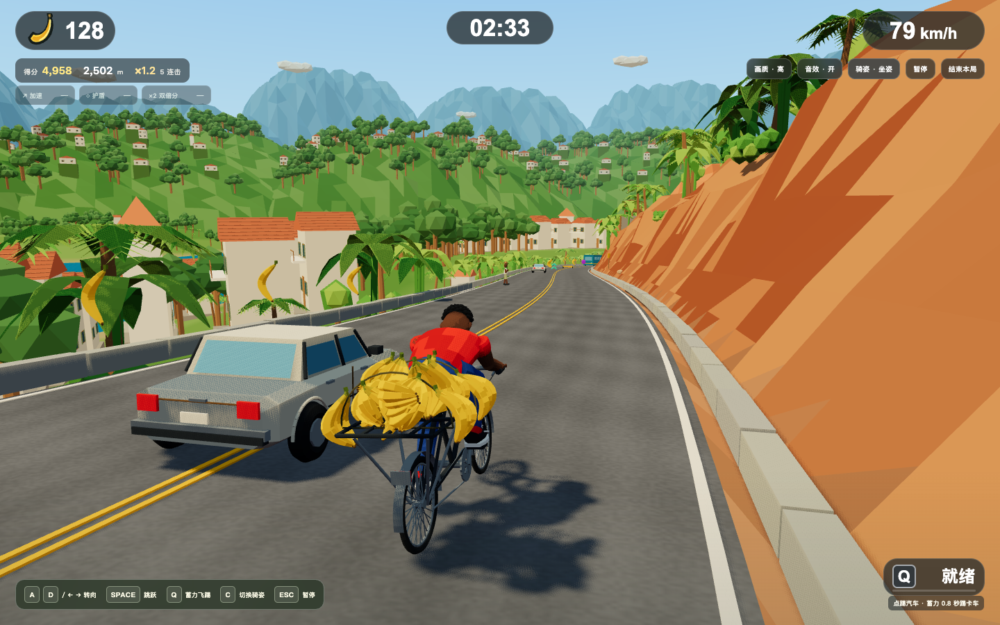

# 彪速骑行 · 无尽香蕉山道

按用户最新要求，已将有限配送原型改为低多边形无尽骑行。沿用图 A 的人物、二八大杠、香蕉与热带山景配色；开始后自动前进，沿路拾香蕉、跳障、自由侧避、拾道具、蓄力踢车，碰撞或主动结束时结算。

目前是可玩的开发原型，整体严格1:1还原尚未完成。详细卡点、证据范围和下一步见[当前卡点报告](docs/BLOCKERS.md)。



## 开始玩

```sh
pnpm install --frozen-lockfile
pnpm dev
```

本地默认入口 http://127.0.0.1:5173/ 。需Node24+（本次24.19.0）和pnpm。仓库已有全部运行GLB，直接玩无需Blender；`sh ./start.sh`也可使用现有依赖启动。

| 输入 | 行为 |
|---|---|
| 开始按钮 / Enter | 3 秒倒计时后自动骑行 |
| A/D 或左右箭头 | 保留连续横移、惯性响应，不锁定轨道 |
| Space | 跳跃越过路栏、木箱或动物 |
| Q 按住后松开 | 0.8 秒蓄力踢卡车；汽车可点踢，冷却 18 秒 |
| C / 顶部骑姿按钮 | 默认坐姿踩踏，切换站姿特技；重开恢复坐姿 |
| Esc / 暂停 | 暂停、继续；失焦也暂停 |
| 结束本局 | 主动结算 |
| 窄屏触控按钮 | 按住左右移动、跳跃、蓄力/松开踢车 |

基础速度 12 m/s，每 250 米增加 1 m/s，上限 26 m/s。加速拾取持续 5 秒并乘 1.25；护盾持续 8 秒且挡一次碰撞；双倍分持续 10 秒。同种道具刷新时间，三种效果可共存。

每米 1 分、每根香蕉 10 分、成功跳障 50 分、踢卡车/汽车 200/100 分。奖励间隔不超过 2.5 秒延续连击，每 5 次奖励提升 0.2 倍，最多 2 倍。双倍分作用于全部得分，连击只作用于奖励。结果与本机纪录保存在 localStorage；无香蕉达标、超时或终点。

完整规则、各类碰撞与通过条件、状态机、原逻辑修改清单和资产规格见 [无尽改造规格](docs/endless-design.md)，任务与证据见 [实施清单](docs/endless-plan.md) 和 [执行记录](docs/progress.md)。旧文档中的配送模式为历史版本，已被最新规格替代。

## Blender 资产与动作

所有可见三维模型都由本地 Blender 5.2.2 LTS 执行 `scripts/build-assets.py` 建模；没有下载模型或用 Three.js 基础几何体替代模型。41 个 GLB 共 20,410,276 字节（20.41 MB），manifest 记录面数与来源。

- `assets/blender/asset-library.blend`：全部角色、自行车、香蕉、障碍、道具、环境与粒子网格。
- `assets/blender/endless-course.blend`：20个80 m弯道路段、标线、护栏及原生路侧布局。
- `assets/blender/standing-motion.blend`：同场摆放人物与自行车，时间轴含坐姿踩踏、坐站切换、站立平衡、起跳、腾空、落地、蓄力、飞踢和恢复坐姿。
- `assets/blender/valley-layout.blend`：沿真实曲线作者的河谷和水面、六处近岸/对岸聚落共296座建筑及石基础、2400棵森林树、160棵棕榈和远山；18座远丘另有3600棵森林树和351座村落建筑，其中约76%为宽矮房屋、5座钟塔。远树与近树共用同一172面模型和AO；远处底座使用共享12面土绿阶地，完整占地与根点贴合实际远丘。布局由Blender导出，运行时将共享模型转换为实例。
- 默认坐姿两手扶把、双脚跟随脚踏；按 C 或“骑姿”按钮切换为一脚踩车把、一脚踩车座的站姿。运行时使用 Blender 对象关节与手脚逆向运动学，行进中平滑切换，飞踢后回到所选骑姿；没有 Rigify 皮肤骨骼或导出动画播放。暂停冻结骑姿，结束后禁用切换，重开恢复坐姿。
- 角色使用宽大红衫折面、完整短袖和蓝裤褶皱；自行车保留经典大梁，补充皮座、弹簧、链盘与弧形链罩。新模型保留原关节和动作目标。
- 香蕉以五条宽折面、窄边倒角、饱满果腹和青蒂建模，单根332面、五蕉束1532面。`bananaRack.glb` 保存 Blender 制作的20束共享几何；底层平放、上层交错、外侧下垂，运行时直接导入作者矩阵。开局空架，每拾取5根显示一束，最多显示20束，20根后显示捆绳；视觉容量不限制拾取数或得分。
- 本地 Blender 制作 20 段真实弯曲的 80 m 柏油山路、双黄线、石护栏与红土山坡，1600 m 后循环且下降 64 m。柏油颗粒贴图内嵌 GLB；植被、岩壁、房屋与石基础的作者布局贴合实际地形。
- 19 类主要模板在 Blender 将短程 AO 烘入顶点色，源文件保留原色和 AO 系数；导出的标准 `COLOR_0` 与源颜色逐三角形核对。天空使用 Blender 原生球网格，Three.js 绘制渐变色。
- 山路右侧为连续红岩高坡，路外负X地形加密为24列、纵向每2m采样；周期起伏与横向偏移形成岩层，距中心10m处高约5.3～7.9m，左侧保留下坡河谷。宽矮岩块完整封底埋入实际坡面约150mm，路侧房屋基础按完整占地裁切求高度。Blender 另作者环绕的24座多脊线远山、18座低丘和24片云，Three.js直接实例化原生矩阵；柏油、标线、护栏和道路中心保持原样。水面采用内嵌的低对比细纹。

```sh
/Applications/Blender.app/Contents/MacOS/Blender --background --python-exit-code 1 --python scripts/test-blender.py
```

该命令会重新建模、导出并验证源文件、足底接触与障碍尺寸。

## 实现

Vite + TypeScript 规则/物理 + Three.js + Rapier + HTML/CSS。60 Hz 固定模拟和扫掠碰撞控制游戏结果，展示与动画不重复发奖。每 80 m 确定性生成组合，保留前方 480 m、后方约 80 m 的逻辑对象；路面与场景实例围绕玩家滚动，远距离使用相对原点坐标。

GLTFLoader 加载本地模型；InstancedMesh 合批香蕉、植被、远山、粒子；MeshToonMaterial 三层明暗、暖光、雾、动态阴影和速度 FOV；对象池回收障碍。Rapier 负责被踢车辆的冲量、翻滚和与 Blender 路面碰撞。背景与前景分两次渲染，性能检查统计两次及阴影的实际 GL 调用总数。

树木、香蕉叶、石头、建筑和护栏在近处投影；投影实例与场景共享 Blender 几何，按距离筛选。植被颜色与阴影使用相同风变形，暂停时一起冻结，低画质关闭投影。侧后方镜头分开呈现两只车轮与货架，竖屏自动后撤；坐/站切换、满载香蕉、左右倾斜、跳跃与两侧飞踢均检查实际模型是否入镜。踢击星跟随实际踢腿脚，并朝向当前帧相机。

河谷以两个区块滚动复用，地形和水面按道路的周期位移首尾连续；远山、云及远丘上的森林/村落放在固定远景根，只消费一份原生作者矩阵。远坡新增五个实例批次，保留现有骑行镜头。比赛 HUD 为香蕉左上、计时居中、速度右上的半透明胶囊，得分/距离/连击和道具计时作辅助信息；窄屏长数字保持可读。

`route.ts` 读取 Blender 导出的 2 m 路线采样，按周期位移延伸。模型、拾取物、相机目标与 Rapier 共用路线坐标；以骑手位置和朝向作局部原点，自由横移仍连续且 D 向屏幕右。飞行车辆与粒子在弯道中同时重定位姿态及速度。渲染复用 8 个路段槽，物理复用两组原生道路表面。

## 验证

```sh
pnpm test
pnpm check:assets
pnpm build
```

浏览器脚本需 Playwright 和 Chrome，启动服务后可运行：

```sh
node scripts/browser-check.mjs
node scripts/fidelity-check.mjs
node scripts/context-check.mjs
node scripts/landscape-check.mjs
node scripts/riding-check.mjs
node scripts/art-check.mjs
node scripts/valley-check.mjs
node scripts/curved-check.mjs
node scripts/lighting-check.mjs
node scripts/hero-check.mjs
node scripts/cargo-clearance-check.mjs
node scripts/landscape-art-check.mjs
node scripts/settlement-check.mjs
```

可用 `PLAYWRIGHT_MODULE` 指向现有 Playwright ESM 入口，`GAME_URL` 指向开发或生产预览地址。脚本分别检查真实键盘长距离骑行、导入模型/窄屏触控、WebGL 冻结恢复和百万米坐标下的有界资源。最后一项注入距离作隔离测试，不冒充玩家跑出的成绩。截图与原始报告在 `artifacts/`。

浏览器QA不是基本运行依赖：需要单独安装Playwright以及Google Chrome，现有脚本使用`channel:'chrome'`。原生检查必要的历史基线已随仓库保存到`tests/fixtures/blender/`，报告写入自动创建的`artifacts/`。`verification/`提供选取的最近游戏证据；本文其他历史before快照与日志在原开发机保留，历史差异检查需要对应快照，不能在缺少它们时冒称已复验。

只检查已保存的弯路源，可运行 `Blender --background --python-exit-code 1 --python scripts/test-curved-road.py`；检查原生网格接缝、树根、基础占地及岩壁底缘。

只检查四个已保存的 Blender 源及其 GLB 颜色，可运行 `Blender --background --python-exit-code 1 --python scripts/test-lighting-assets.py`。默认检查当前模型的 AO 烘焙几何签名、源颜色与全部导出颜色；加 `-- --historical` 才与光影修改前的旧模型基线比较，主角重建后不要求符合旧形状。光影与镜头生产验证见 `artifacts/lighting-report.json`。

主角源与实际 GLB 的共享几何、货架接触、手脚支撑和原动作时间轴可用 `Blender --background --python-exit-code 1 --python scripts/test-hero-assets.py` 只读验证。`hero-check.mjs` 分开记录满载渲染夹具和真实 C/A/D/Space/Q 输入，满载夹具不是玩家成绩。

当前场景的原生岸坡、环绕布局及路面不变项可用 `Blender --background --python-exit-code 1 --python scripts/test-landscape-assets.py` 验证；`test-rock-ridges.py`检查实际岩层起伏和山脊网格，`test-scenery-support.py`用完整多边形裁切核验全部基础和封底。`landscape-art-check.mjs`先真实开始游戏，再用冻结的场景夹具检查三尺寸、转弯、精确周期两侧和远距离；通过开关原生远山比较实际GL像素，HUD来自前一RAF、100根货量为夹具。`scene-baseline-check.mjs`默认对`rock-before-assets`快照验证其余36模板与路线不变；`SCENE_BASELINE/SCENE_CHANGED/SCENE_REPORT`可指定历史范围。历史主角/场景基线保留，不要求当前有意改变的环境匹配旧形状。

远坡布景阶段只改变`valley.glb`，用`SCENE_BASELINE=artifacts/panorama-props-before-assets SCENE_CHANGED=valley SCENE_REPORT=artifacts/panorama-props-unchanged-assets.json node scripts/scene-baseline-check.mjs`核对该阶段其余40模板。`test-settlement-assets.py`核验真实路线对齐、水面93行和近聚落源，`test-panorama-props.py`核验远坡森林共享几何及全部根点，`test-scenery-support.py`检查包含远村落的完整基础。`settlement-check.mjs`保留原27样本和门槛，分别开关真实近/远树冠与建筑测量GL像素；不把裸绿色丘陵算作森林。该阶段27样本覆盖检查通过，历史证据见`artifacts/panorama-props-production-final-status.json`；整体1:1还原仍未完成。

最新香蕉美术只改变`banana/looseBanana/bananaRack`，可用`node scripts/hero-baseline-check.mjs artifacts/hero-organic-before-assets banana,looseBanana,bananaRack artifacts/hero-organic-unchanged-assets.json`检查其余38模板、路线与材质。只读复核发现坐姿后腰仍有一束穿插，已在Blender后移200mm；`cargo-clearance-check.mjs`的六个满载坐/站/跳跃/踢击世界三角形相交检查从RED转GREEN。源/导出颜色、原生货架接触、58项测试、生产24完整Q窗口1368帧和完整2502.21m跑局通过；自然拾128蕉、踢飞2辆重卡、三道具/跳障/坐站/暂停/主动及碰撞结束/重开均验证，峰值153次整帧GL调用。记录见`docs/superpowers/plans/2026-10-13-hero-organic.md`及`artifacts/hero-organic-production-status.json`。满载图是隔离夹具，`hero-organic-production-endless-running.png`是自然拾取跑局截图；本轮完整证据版本见`artifacts/hero-organic-build-fingerprint.json`，整体1:1尚未完成。

性能目标仍为中端电脑 60 fps、每帧绘制调用 <300、首屏 <30 MB。自动化时钟证明功能与调用数量；本机短帧时间采样不等于中端硬件验收。尚未实现模型 LOD、烘焙 lightmap、压缩 GLB/KTX2、在线排行、完整物理轮胎或车辆零件拆解。
