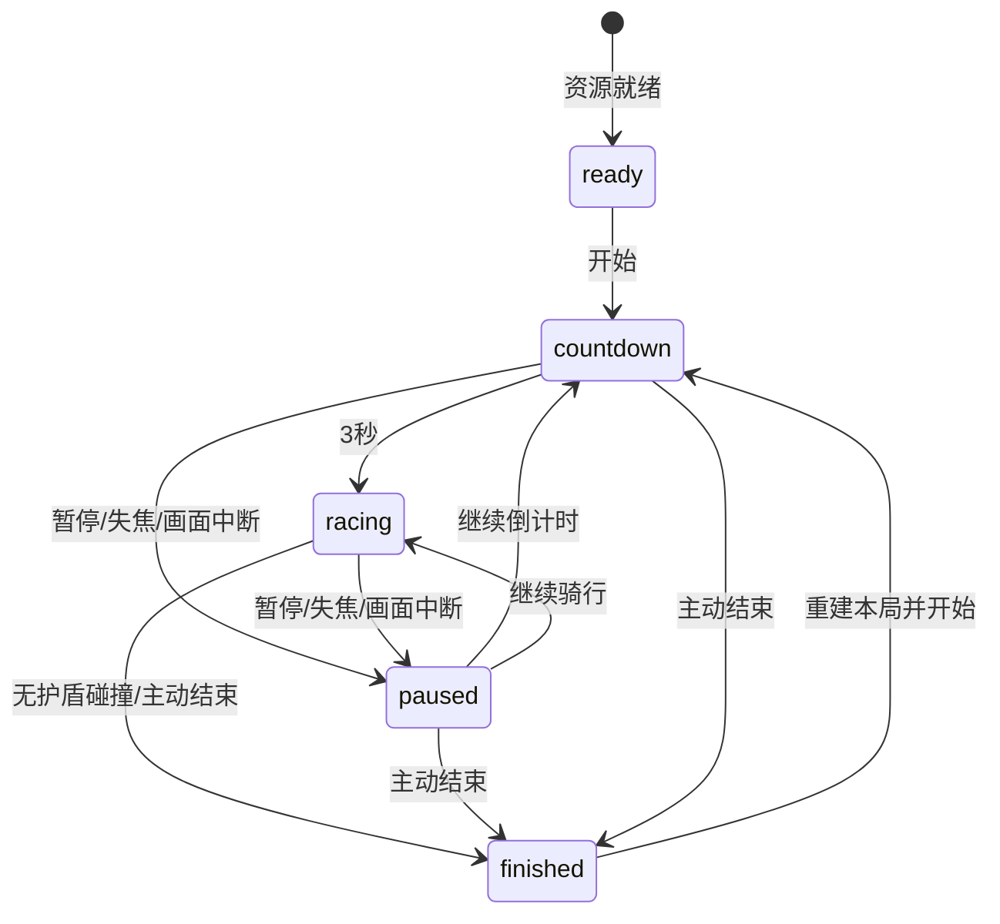

# 无尽香蕉骑行：改造规格

2026-10-28 更新。以用户已确认的无尽跑酷规则取代有限配送；以 `assets/reference/style-a-2026-10-28.png` 为暖色街机风基准。辨识性模型由 Tripo H3.1 生成，经过本地 Blender 精修、绑定、动作与LOD制作，再由 Three.js 加载、实例化和展示。电脑浏览器，A/D 或左右箭头持续自由移动，Space 跳跃，保留 Q 蓄力踢车；不锁定三条轨道。按最新补充默认坐姿踩踏，C 或骑姿按钮切换站姿。

## 流程与规则

资源加载 → ready → 点击开始 → countdown（3 秒）→ racing → 碰撞或主动结束 → finished → 再来一局。countdown/racing 可进入 paused，并返回原状态。失焦和 WebGL context 丢失冻结全部计时；不自动恢复。没有终点、配送、装货、香蕉达标线或超时淘汰。

- 自动基础速度 `min(26, 12 + floor(distance / 250))` m/s（43.2–93.6 km/h）。加速道具持续 5 秒，速度乘 1.25，最高 32.5 m/s；W/S 不再控制速度。
- E 冲刺持续1.5秒、冷却6秒；与加速道具使用同一1.25倍速度效果，不相乘，也不缩短已有加速剩余时间。
- 骑姿是独立展示状态 `seated | standing`，不改变速度、自由横移、碰撞、得分、技能或道具。ready/countdown/racing 可切换，paused/finished 或画面中断禁用；重开恢复坐姿。行进中约 0.3 秒切换，跳跃和飞踢叠加在当前骑姿上。
- 距离每米 1 分；香蕉每根 10 分；成功越过低障碍 50 分；踢飞卡车/汽车 200/100 分。得分由模拟决定，动画不能发奖。
- 香蕉、成功跳障和踢车延续连击；相邻奖励间隔不得超过 2.5 秒。每连续 5 次奖励，奖励倍率加 0.2，最多 2 倍。距离分不吃连击倍率。碰撞被护盾挡住后清空连击。
- 双倍分道具持续 10 秒，对距离与动作奖励均乘 2。护盾持续 8 秒且只抵挡一次碰撞，消耗后 0.65 秒免疫，已接触障碍标记为命中，避免长障碍同次接触连续扣命。
- 香蕉和道具靠接触自动拾取。香蕉按单根累计，沿安全路线或可跳越的弧线摆放。加速、护盾、双倍分可同时存在；同种重复拾取只刷新持续时间，不叠倍数。
- 无护盾时任一障碍碰撞结束；暂停页或 HUD 的“结束本局”主动结算。保存本机最高分、最远距离。Q 蓄力 0.8 秒可踢卡车，汽车可点踢，命中/挥空均冷却 18 秒；列车、高墙不能踢。
- 同个模拟步先更新移动和计时，再收集拾取物，最后判定障碍；因此同一步触碰护盾会先获得保护。结束后输入不再移动、计时或发奖。重开直接重新倒计时，清除本局拾取、动作、飞车、粒子和冷却。

## 障碍与公平布局

碰撞使用连续横向坐标与前后步进的扫掠 AABB，玩家横向半径 0.36 m，前后半径 0.8 m。低障碍另检查跳跃高度；大型障碍从地面延伸超过最大跳高。视觉模型与碰撞尺寸在同一配置中标注。

| 类型 | 宽×长×高（m） | 通过条件 |
|---|---|---|
| 低路栏 barrier | 2.2×0.7×0.5 | 跳跃抬升超过 0.6 m，或移到障碍外侧 |
| 木箱 crate | 1.5×1.2×0.85 | 抬升超过 0.95 m，或左右绕行 |
| 高墙 wall | 3.2×1.0×2.8 | 横向离开占用范围，不能跳过/踢走 |
| 纵向列车 train | 2.6×14×3.0 | 在整段车身侧方通过，不能跳过/踢走 |
| 卡车 truck | 2.6×4.9×2.6 | 绕行，或 Q 蓄力踢飞 |
| 汽车 car | 1.8×3.4×1.3 | 绕行，或 Q 踢飞 |
| 行人 pedestrian | 0.7×0.7×1.8 | 绕行；按时间缓慢横穿 |
| 动物 goat | 0.8×1.2×0.8 | 抬升超过 0.9 m，或绕行；可横穿 |

按 80 m 区块确定性生成，初段教学间隔宽，随后加入“跳栏→墙绕行”“长列车旁香蕉链”等组合。组合保留至少一条玩家宽度以上的连续走廊，横向切换预算按原 3.5 m/s 转向速度计算，不能生成封满路面的必撞横排。坐标是连续的；模板摆放点不构成玩家轨道。

只保留前方 480 m、后方约 80 m 的障碍与拾取物。道具不放入障碍体积，香蕉不穿过墙/列车；跳栏上方允许香蕉弧线。超过旧 2000 m 后继续生成，不循环同一有限关卡。渲染使用相对玩家的原点坐标，避免长距离浮点抖动。

## 模块合同

`src/game.ts` 导出 `createGame(course, handlingOverrides?)`、`startRun(g)`、`advance(g,input,delta)`、`togglePause(g)`、`toggleStance(g)`、`endRun(g)`、`resultFor(g)`、`clamp`、`FIXED_STEP`、`obstacleSpecs`。

- Course：`mode:'endless'`, `seed:number`, `chunkLength:80`, `lookAhead:480`，原生道路 `step:2, points:[{s,x,y,z,yaw}], road:{period:1600,advance:{x,y,z}}`；可选 `procedural:false, obstacles:[], pickups:[]` 用于规则夹具，不作为正常关卡配置。
- Phase：`ready | countdown | racing | paused | finished`；`resumePhase` 保存暂停前状态。
- Input：`steer:number (-1..1), jump:boolean, kick:boolean, dash:boolean`；可选 `jumpPressed,dashPressed,cancelKick:boolean` 是一次性物理按下/取消命令。没有 load/launch/throttle/brake/brace/deliver。
- 输入适配：`src/inputBuffer.js` 的 `ActionBuffer` 共用键盘/触控意图。短按保留到真实模拟步；`advance` 返回实际步数，0步不能清缓冲。物理按下/取消只应用于本次追赶的首个tick，不能跨多个tick重复触发；普通持续按住由 `held` 去重。触控取消在事件发生时检查其他输入源，最后一个源取消则清蓄力、不踢击/不扣冷却；其他源仍按住时不能擦除其随后正常松手。暂停、失焦、结束和重开清全部意图。
- GameState：`course,handling,phase,resumePhase,stance:'seated'|'standing',s,lane,lateralSpeed,speed,baseSpeed,elapsed,score,bananas,combo,chain,chainTimer,countdown,accumulator,jumpHeight,jumpVelocity,airTime,charge,kickPose,kickSide,kickedCount,invulnerable,cooldowns:{kick,dash},buffs:{boost,shield,double},held:{jump,dash},events,failure,endReason:'collision'|'quit'|'',obstacles,pickups,nextChunk`。
- Obstacle：`id,type,s,lane,originalLane,kicked,hit,passed,jumpCleared,flight,kickSide?,crossing?,seed?,frequency?,speed?,lift?`。拾取物：`id,type:'banana'|'boost'|'shield'|'double',s,lane,height,collected`。height 为道路上方香蕉/道具中心高度。
- `obstacleSpecs[type]`：`width,length,height,jumpable`，width/length 为全尺寸。
- Event：`pickup`（`kind,count,points`）；`kick`（`id,charged`）；`miss`（`charged`）；`collision`（`id`）；`shield`（`id`）；`stunt`（`points,label`）；`jump | launch | go | finish | dash`。
- 接口的完整类型以 `src/game.ts` 为准。
- `resultFor(g)`：`total` 整数分、`distance` 整数米、`bananas`、`elapsed`、`reason`。不再输出通关排名或配送奖章。
- View：`new GameView(canvas,onProgress)`, `await view.load()`, `view.course`, `view.update(g,dt)`, `view.events(events,g)`, `view.reset(g)`。main 保留显式重开 reset 和 WebGL 丢失恢复。相同游戏在paused首次绘制后停止重复提交，resize/画质/上下文恢复标记重绘；继续、结算及新局不命中暂停缓存。调试只暴露读取 `window.__bananaGame={get game(){…},view}`，不要增加奖励作弊到生产代码。

## 资产、动作与场景合同

保存的 `.blend` 是导出权威。历史 `build-*.py` 不用于重建当前模型；`export-saved-assets.py` 读取 manifest 中的源文件/根节点，只读导出，不保存或重造网格。所有模型按米制制作，GLB 使用Y-up、应用缩放；角色保留实际蒙皮/UV，环境允许有来源记录的顶点色LOD。压缩不能改变顶点、索引、动画、布局或元数据。

| 类别 | 当前规格与构建要求 | 权威保存源 |
|---|---|---|
| 主角 | 1.85m自然身高、19,121三角面、Tripo原始65骨蒙皮、最多4权重、2K基础色、16Actions/NLA | `assets/blender/tripo/hero.blend` |
| 自行车 | 20,802三角面、2K基础色、1.22m轴距/.36m轮半径；独立车轮/曲柄、脚踏、车把/座/货架接触标记 | `assets/blender/tripo/bicycle.blend` |
| 香蕉货物 | 20束/4种共享几何，中央→两翼分层堆叠，真实果弯/青蒂/深浅贴图；每5次拾取显示1束 | `assets/blender/tripo-cargo.blend` |
| 单蕉/道具 | 逻辑拾取高度对应几何中心；单蕉、青色加速、蓝盾、紫色双倍；512基础色 | `assets/blender/tripo-pickups.blend` |
| 卡车 | 25,985三角面、16分件；门/尾板/货箱可释放，零件枢轴在真实几何中心，碰撞半尺寸按GLB的Y-up轴序 | `assets/blender/tripo-truck.blend` |
| 行人/山羊 | 原始纹理与几何分出实际腿部，独立摆动；山羊高.8m，与可跳碰撞体对应 | `tripo-pedestrian.blend` / `tripo-goat.blend` |
| 其他障碍 | 汽车、黄黑矮栏、木箱、墙、14m长车厢；尺寸与上表碰撞配置统一，轮廓可快速识别 | `assets/blender/tripo/` 对应文件 |
| 场景 | 13类真实Tripo场景母版派生植被、红岩、热带房屋、钟楼、山云及LOD；连续道路/地形/水面为Blender功能网格 | `assets/blender/tripo-environment.blend` |
| 特效 | 真实Tripo冲击星，朝相机展示；本地低模尘土/火花载体，尺度与运行粒子参数匹配 | `assets/blender/tripo-effects.blend` |
| HUD图标 | 从同版香蕉/三道具模型在Blender渲染192px透明PNG，统一形色 | `public/ui/*.png` |

角色由 AnimationMixer 播放原生动作，接触IK对齐实际新车标记。默认坐姿、C切站姿；跳跃、左右蓄力/踢击、受击、倾斜与失败都有对应片段。切换反向从当前姿态继续，暂停冻结。接触、连续姿态净空与相机遮挡分别验证，详见 [骑姿规格](riding-poses.md)。

货架视觉最多100根，超过100仍拾取/计分；80根起显示两条绑绳。货物每5根递增一束，使用20个原生作者矩阵和4份共享网格。掉落的表现香蕉、拾取香蕉与界面图标遵循同一母版语言，货物不是逐果实刚体。

道路维持20段×80m的真实弯曲柏油、标线、护栏及原生地形，1600m周期下降64m；`course.json` 2m采样和Rapier地形使用同一坐标。只保留8个近景路段槽；复用作者矩阵，切换共享几何，避免每段重新建模型。路边树/房屋/红岩必须检查完整占地与岩脚三角形对地形的支撑，不能只检查中心点。村落/蕉林面向左侧海湾、红岩位于右侧上坡。

河谷/远景沿用作者布局，通过共享源几何合批。树的近/中/远LOD分别796/94/20三角面，保留同源轮廓与颜色；低档两份滚动河谷都降低森林密度并切远LOD。远坡房屋必须完整贴合指定坡面，不能为增加数量在陡坡上架空房基。云保留H3.1的立体宽高比例，运行时使用不受暗面光照影响的材质。

全部29个生成母版只生成一次；来源账本包含任务地址、原始SHA、输出映射与实际扣费。首屏只加载22个运行GLB；路边植被/建筑/岩石原型直接复用已加载的作者路段，避免重复请求15套相同模型。全部60个导出中包含兼容入口、LOD及变体，不能把60误报为付费生成次数。

## 技术与性能要求

- Three.js：GLTFLoader+MeshoptDecoder、SkeletonUtils克隆、AnimationMixer、InstancedMesh、池化与相对原点；相机随速度改变视野，飞踢拟合实际人/车/货物范围，并检查地形遮挡及主体像素高度。
- 材质：保留Tripo真实基础色、UV、透明/裁切与顶点色存在状态，Toon色阶和暖光统一风格；缺COLOR_0时不能强制启用顶点色。源8K母版保留，运行主体2K、环境1K、小物件512。
- 光照：近景有限范围动态阴影；低档关闭阴影并减少植被。云使用明亮不受光材质，速度线/冲击光晕用透明/加法混合；不为少数发光物体增加整屏Bloom通道。
- 规则：固定60Hz，扫掠横纵接触区间；低障碍成功空中接触被保留，在完全通过后只奖励一次，最高速单步跨过也不能丢奖。
- Rapier：飞车前滚留在前方视野；最多12个、3秒寿命的装饰零件，不参与计分。对象回收恢复所有部件，旧碎片不再引用已复用模型。
- 会话：正常每局新种子，显式 `?seed=2817` 等用于确定性重放，结算显示种子。画质/声音/最高纪录保存在localStorage；损坏、禁用或写失败不能阻止开局。
- 性能目标：中端桌面60fps、每帧完整GL调用<300、首屏运行资源<30MB。使用真实rAF统计所有长帧；虚拟时钟功能检查不代表FPS。Apple M6结果不替代GTX1650/IrisXe或手机真机验收。
- 生产：构建后预生成Brotli/gzip，内置Node服务器按浏览器能力传输；CI固定Node/Playwright/官方Blender版本与SHA，原生源只读重导并严格比对指纹。未使用KTX2、完整lightmap或在线排行榜。
- 首用准备：加载期对高/低档和前景/远景分别预编译，并实际进行1像素默认framebuffer绘制；不能只把远景关闭太阳投影当作低档关闭shadowMap。完成后恢复全部对象可见/裁剪、阴影与当前画布尺寸，首击帧时及启动时间分别复验。

| 模块 | 关键文件 |
|---|---|
| 状态/速度/生成/扫掠碰撞/计分 | `src/game.ts` |
| 跨帧动作意图、输入源取消、模拟消费 | `src/inputBuffer.js`、`src/main.js` |
| 会话种子/偏好与存储容错 | `src/session.js`、`src/main.js` |
| GLB/LOD/池化/材质/镜头/特效 | `src/view.js`、`src/kickCamera.js` |
| 蒙皮动作与真实接触IK | `src/mixamoRiderAnimation.js` |
| 路线与相对原点 | `src/route.ts` |
| 飞车与零件物理 | `src/physics.ts` |
| 键盘/触控/HUD/存档 | `src/main.js`、`index.html`、`src/reference.css` |
| WebAudio与缓存 | `src/audio.js` |
| 来源/导出/无损压缩/门禁 | `scripts/banana-tripo/`、`scripts/export-saved-assets.py`、`.github/workflows/assets.yml` |

关卡存在性采样用 `pnpm check:course`：12种子×3里程区间，每段12秒、0.1秒控制决策、128个候选状态，随后正式60Hz扫掠规则重放。排除拾取物与防御技能，保留加速压力和入口车位夹具；高里程可以从三个候选车位选择。不能由单个障碍宽度或这些有限样本推断全部随机布局、入口连通性或真人可读性。

最新架构/输入/关卡/暂停及性能检查见 [技能复审报告](banana-reaudit-20261028.md)，未修改的资源/动作制作证据见 [资产重制报告](banana-audit-20261028.md)。不同版本和测量方式的数字不混作同一验收结论。

## 删除/修改清单

删除开场装货、100 根满载/50 根交付门槛、终点门和交付判定、240 秒超时、香蕉掉光失败、W/S 手动油门刹车、E 护货技能、配送加权奖章。替换有限 course.length/全图障碍表为滚动生成；替换货量/终点进度 HUD 为距离、拾取数、得分、连击和道具计时；替换旧配送存档键、浏览器通关测试和参考静止骑行帧。保留连续横移参数、Space、Q、暂停、声音、存档、动态踢车、Blender 来源证据。
