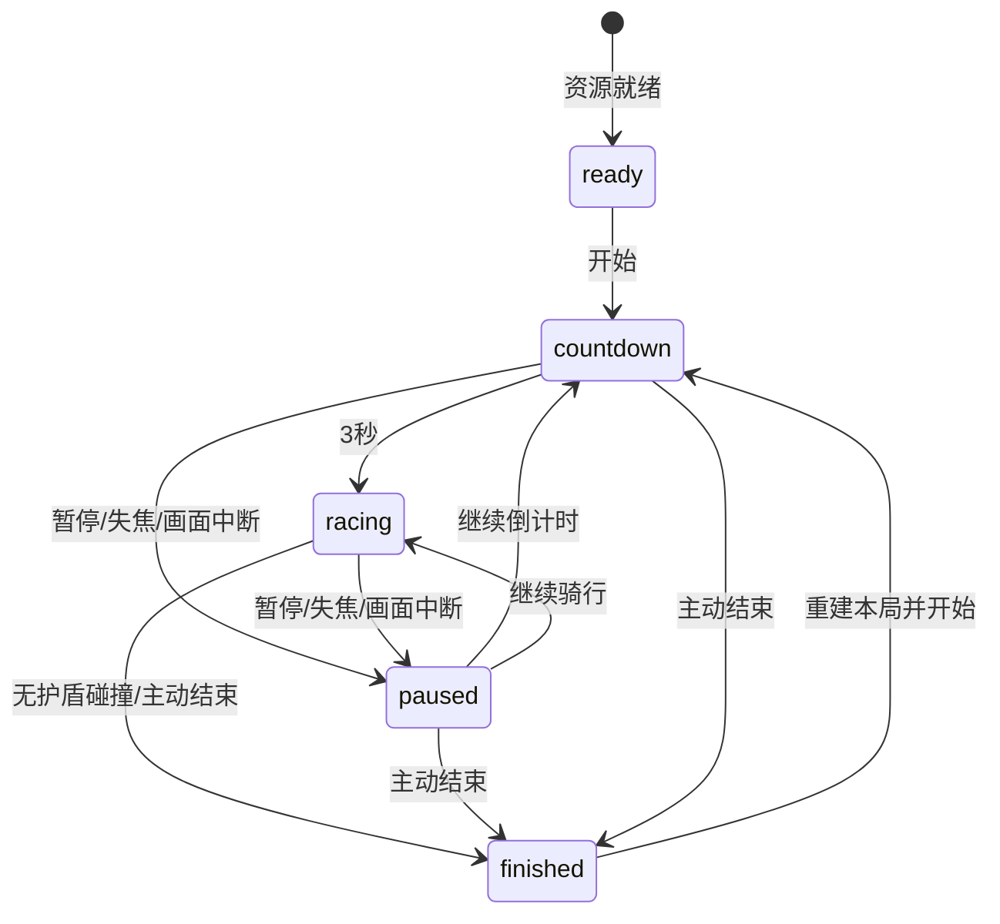

# 无尽香蕉骑行：改造规格

2026-10-13。以用户最新无尽跑酷要求取代有限配送规则；沿用 `assets/reference/style-a.png` 的暖色低多边形街机风。所有可见三维模型由本地 Blender 建模，three.js 只负责加载、实例化、动画与特效。电脑浏览器，A/D 或左右箭头持续自由移动，Space 跳跃，保留 Q 蓄力踢车；不锁定三条轨道。按最新补充默认坐姿踩踏，C 或骑姿按钮切换站姿。

## 流程与规则

资源加载 → ready → 点击开始 → countdown（3 秒）→ racing → 碰撞或主动结束 → finished → 再来一局。countdown/racing 可进入 paused，并返回原状态。失焦和 WebGL context 丢失冻结全部计时；不自动恢复。没有终点、配送、装货、香蕉达标线或超时淘汰。

- 自动基础速度 `min(26, 12 + floor(distance / 250))` m/s（43.2–93.6 km/h）。加速道具持续 5 秒，速度乘 1.25，最高 32.5 m/s；W/S 不再控制速度。
- 骑姿是独立展示状态 `seated | standing`，不改变速度、自由横移、碰撞、得分、技能或道具。ready/countdown/racing 可切换，paused/finished 或画面中断禁用；重开恢复坐姿。行进中约 0.3 秒切换，跳跃和飞踢叠加在当前骑姿上。
- 距离每米 1 分；香蕉每根 10 分；成功越过低障碍 50 分；踢飞卡车/汽车 200/100 分。得分由模拟决定，动画不能发奖。
- 香蕉、成功跳障和踢车延续连击；相邻奖励间隔不得超过 2.5 秒。每连续 5 次奖励，奖励倍率加 0.2，最多 2 倍。距离分不吃连击倍率。碰撞被护盾挡住后清空连击。
- 双倍分道具持续 10 秒，对距离与动作奖励均乘 2。护盾持续 8 秒且只抵挡一次碰撞，消耗后 0.65 秒免疫，已接触障碍标记为命中，避免长障碍同次接触连续扣命。
- 香蕉和道具靠接触自动拾取。香蕉按单根累计，沿安全路线或可跳越的弧线摆放。加速、护盾、双倍分可同时存在；同种重复拾取只刷新持续时间，不叠倍数。
- 无护盾时任一障碍碰撞结束；暂停页或 HUD 的“结束本局”主动结算。保存本机最高分、最远距离。Q 蓄力 0.8 秒可踢卡车，汽车可点踢，命中/挥空均冷却 18 秒；列车、高墙不能踢。
- 同个模拟步先更新移动和计时，再收集拾取物，最后判定障碍；因此同一步触碰护盾会先获得保护。结束后输入不再移动、计时或发奖。重开直接重新倒计时，清除本局拾取、动作、飞车、粒子和冷却。

## 障碍与公平布局

碰撞使用连续横向坐标与前后步进的扫掠 AABB，玩家横向半径 0.36 m，前后半径 0.8 m。低障碍另检查跳跃高度；大型障碍从地面延伸超过最大跳高。视觉模型与碰撞尺寸在同一配置中标注。

| 类型 | 宽×长×高（m） | 通过条件 |
|---|---|---|
| 低路栏 barrier | 2.2×0.7×0.5 | 跳跃抬升超过 0.6 m，或移到障碍外侧 |
| 木箱 crate | 1.5×1.2×0.85 | 抬升超过 0.95 m，或左右绕行 |
| 高墙 wall | 3.2×1.0×2.8 | 横向离开占用范围，不能跳过/踢走 |
| 纵向列车 train | 2.6×14×3.0 | 在整段车身侧方通过，不能跳过/踢走 |
| 卡车 truck | 2.6×4.9×2.6 | 绕行，或 Q 蓄力踢飞 |
| 汽车 car | 1.8×3.4×1.3 | 绕行，或 Q 踢飞 |
| 行人 pedestrian | 0.7×0.7×1.8 | 绕行；按时间缓慢横穿 |
| 动物 goat | 0.8×1.2×0.8 | 抬升超过 0.9 m，或绕行；可横穿 |

按 80 m 区块确定性生成，初段教学间隔宽，随后加入“跳栏→墙绕行”“长列车旁香蕉链”等组合。组合保留至少一条玩家宽度以上的连续走廊，横向切换预算按原 3.5 m/s 转向速度计算，不能生成封满路面的必撞横排。坐标是连续的；模板摆放点不构成玩家轨道。

只保留前方 480 m、后方约 80 m 的障碍与拾取物。道具不放入障碍体积，香蕉不穿过墙/列车；跳栏上方允许香蕉弧线。超过旧 2000 m 后继续生成，不循环同一有限关卡。渲染使用相对玩家的原点坐标，避免长距离浮点抖动。

## 模块合同

`src/game.ts` 导出 `createGame(course, handlingOverrides?)`、`startRun(g)`、`advance(g,input,delta)`、`togglePause(g)`、`toggleStance(g)`、`endRun(g)`、`resultFor(g)`、`clamp`、`FIXED_STEP`、`obstacleSpecs`。

- Course：`mode:'endless'`, `seed:number`, `chunkLength:80`, `lookAhead:480`，原生道路 `step:2, points:[{s,x,y,z,yaw}], road:{period:1600,advance:{x,y,z}}`；可选 `procedural:false, obstacles:[], pickups:[]` 用于规则夹具，不作为正常关卡配置。
- Phase：`ready | countdown | racing | paused | finished`；`resumePhase` 保存暂停前状态。
- Input：`steer:number (-1..1), jump:boolean, kick:boolean`；没有 load/launch/throttle/brake/brace/deliver。
- GameState：`course,handling,phase,resumePhase,stance:'seated'|'standing',s,lane,lateralSpeed,speed,baseSpeed,elapsed,score,bananas,combo,chain,chainTimer,countdown,accumulator,jumpHeight,jumpVelocity,airTime,charge,kickPose,kickSide,kickedCount,invulnerable,cooldowns:{kick},buffs:{boost,shield,double},held:{jump},events,failure,endReason:'collision'|'quit'|'',obstacles,pickups,nextChunk`。
- Obstacle：`id,type,s,lane,originalLane,kicked,hit,passed,flight,kickSide?,crossing?,seed?,frequency?,speed?,lift?`。拾取物：`id,type:'banana'|'boost'|'shield'|'double',s,lane,height,collected`。height 为道路上方香蕉/道具中心高度。
- `obstacleSpecs[type]`：`width,length,height,jumpable`，width/length 为全尺寸。
- Event：`pickup`（`kind,count,points`）；`kick`（`id,charged`）；`miss`（`charged`）；`collision`（`id`）；`shield`（`id`）；`stunt`（`points,label`）；`jump | launch | go | finish`。
- `resultFor(g)`：`total` 整数分、`distance` 整数米、`bananas`、`elapsed`、`reason`。不再输出通关排名或配送奖章。
- View：`new GameView(canvas,onProgress)`, `await view.load()`, `view.course`, `view.update(g,dt)`, `view.events(events,g)`, `view.reset(g)`。main 保留显式重开 reset 和 WebGL 丢失恢复。调试只暴露读取 `window.__bananaGame={get game(){…},view}`，不要增加奖励作弊到生产代码。

## Blender 制作与运行要求

本地脚本重建资产库，保存 `.blend` 可编辑源、GLB 运行资源及 manifest，另保存可预览动作源 standing-motion.blend。角色、自行车、香蕉、旧障碍与场景重新导出；新增低栏、高墙、列车、三种道具、80 m 路段。维持同一顶点色调色板、米制、应用缩放、glTF Y-up。

实际资产：41个GLB、149个glTF mesh、161465个唯一模板三角面，合计20410276字节（20.41MB）。角色6562、自行车5990、单蕉332、五蕉束/货架共享模板1532、重卡14104、汽车4498、列车3168、直路4420、20段弯路及布景90870、河谷18060、远山1820、前丘2064、天空960三角面。完整静态dist25511768字节（25.51MB）；实例化后的屏幕三角形数量另测。

- 角色：约 1 万三角面，默认坐姿踩踏，站立平衡为可切换动作。一脚踩前车把、一脚踩车座的站姿略夸张但有足底支撑。保留 Leg/Knee/Foot 层级，新增 Elbow/Hand 对象关节；手扶车把、平衡摆臂、跳起收膝、落地压缩、蓄力及踢腿都可运行。头发、五官、手指和鞋底有轮廓。
- 足底支撑：导入 glTF 后，两脚踝目标为 `(-0.30,1.311,0.58)` 与 `(0.04,1.233,-0.21)` 米；当前原生鞋底距实际车把/新皮座约 4.4/2.3 mm，坐姿鞋底与脚踏约 1.6 mm、手与握把约 0.1 mm。L/R 是节点标签，不规定人物解剖学侧别。动作采用对象关节，不是 Rigify 蒙皮骨架；运行时 IK，Blender 时间轴保留可编辑关键姿势。C/骑姿按钮随时切坐/站，跳跃和飞踢作为叠加动作并回到所选骑姿，重开恢复坐姿。
- 自行车：约 6000 三角面，保留经典大梁、转轮、辐条、货架，补圆润皮座、座下弹簧、链盘及弧形链罩；车把和座管承受站姿，香蕉以沿路拾取为主，取消开局满载货墙。
- 香蕉：五条宽折面和窄边倒角、饱满果腹、不同弧线/长度和青蒂；单根拾取与五根小束沿用同一形状/材质语言。Blender 作者20束货架堆货布局导出为 `bananaRack.glb`，子节点 `CargoBundle00` 至 `19` 共享一个网格；底层三束平放并贴实际货架（首束最近距离约0.445mm），上层交错、外侧四束下垂。Three.js 直接使用作者矩阵，以 `min(20,floor(拾取数/5))` 渐增实例数，20根后显示原捆绳；不以视觉容量判输赢。所有掉落/收集可见物也来自 Blender。
- 障碍：低栏黄黑条纹、高墙红土色、列车蓝青色，有清晰尺寸区分；列车沿前进方向放置。车辆保留可踢动力学外形；行人/动物保留可读剪影。
- 道具：加速青色箭头、护盾蓝色盾牌、双倍分紫色“×2”几何标识，统一浮动拾取表现。
- 场景：本地Blender沿同一条作者路线制作20段真实弯曲的80m柏油网格、标线、石护栏与红土山坡，保存endless-course.blend与roadCourse.glb。1600m周期下降64m；course.json导出2m采样的s/x/y/z/yaw与周期位移。植被/路标射线贴在原生地形；路边基础与地形的完整占地裁切求最高/最低高度，岩壁封底按全部三角形与地形交叠的最坏差值埋入150mm，避免只检查底圈的中间悬空。Three.js保留作者矩阵，只切换8个渲染槽内的源几何引用；Rapier加载同一套实际原生道路/地形/护栏面。图A河谷在画面左侧、红岩上坡在右侧。
- 河谷：本地Blender按真实路线作者67×93地形与93行水面，原生点为`(route(s).x+u, route(s).y/(advance.z/1600), height(u,s))`，已有区块缩放后沿程Z与道路对齐。93行源误差最大0.122mm，周期下降64m/色板首尾连续；水面184面、内嵌纹理。六处近岸/对岸聚落共296房屋/钟塔及完整占地石基础、2400森林树/160棕榈；实际水面BVH检查避水，树根距>0.9m，模板和作者矩阵共享。75%森林候选落在近岸，冠幅/高度变化。
- 远坡：18原生远丘基座-25m、作者Z尺度280～360，新增3600棵森林树与351座房屋/钟塔/完整基础，75.72%房屋为宽矮屋顶、5座钟塔。树集中到真实丘陵Z>18m的上坡与脊线，XY尺度6～8、Z6～8.2，根贴全部远丘BVH；建筑完整占地按指定远丘覆盖，顶部还避让所有重叠丘陵。远近森林共用172面模板与顶点AO，远基座单独使用共享12面土绿阶地，近石基础不改。Three.js新增五个共享实例批次，只放在固定远景根，不重复进两块近河谷；现有镜头、角色、规则和道路不改。全场659基础/10封底、全部新根与source COLOR_0通过；27样本原城镇/林冠门槛已通过，整体1:1仍需继续对照。
- 红岩与远景：负X右岸连续抬高，24列、2m纵向的原生路旁地形用周期波形和横向偏移表现岩层；800个完整周期样本距中心10m处约5.306～7.928m高，沿路高差2.622m。独立出露岩块模板约7.16m高，完整封底埋入实际坡面。远山1,820面和前丘2,064面使用宽山体、多脊线与沟壑，面色形成较连续的岩石/植被色块。路面/标线/护栏40个原生表面的几何、UV和颜色不变。Blender的`ValleyMountains/ValleyFoothills/ValleyClouds`仍为24/18/24个环形作者对象，组内共享单几何；Three.js沿用作者矩阵，其他六组河谷仍在两个周期区块中复用。上述结构证据不等于整图高保真完成。
- 光影：本地 Blender 为 19 类模板制作短程顶点 AO，保留原色和系数、只导出标准 COLOR_0；新增原生天空球，运行时渐变天色。近景树木、蕉叶、岩石、建筑与护栏动态投影，投影批次共享模型几何；叶片颜色/阴影使用同一风变形。低画质关闭投影，暂停冻结风。顶点 AO 与尚未实现的 lightmap 分开。
- 相机：桌面侧后方距离 1.6/2.45/4.8 m（侧距/高度/后距），呈现两轮轮廓、头部与红衫肩背；竖屏插值到 1/2.7/8.2 m，跳跃垂直跟随更快。模型完整入镜检查覆盖坐/站、满载货架、横移边缘持续倾斜、跳跃与左右飞踢，不改变原有输入或碰撞尺寸。原生踢击星跟随所踢脚的世界坐标，并朝向当帧相机。
- HUD：沿用图 A 的香蕉左上、计时居中、速度右上三个锚点与白粗数字/深灰半透明胶囊。新增无尽得分、距离、连击和道具计时缩为辅助条；右下保留 Q 状态，C/骑姿、暂停、结束等控制继续可达。窄屏验证六位香蕉数和超过千分钟的计时显示。
- three.js：GLTFLoader、InstancedMesh 共享几何材质，动态对象池/滚动区块，MeshToonMaterial 与冷色阴影，有限范围动态阴影，速度线/冲击/护盾效果。Rapier 管理踢车飞行；规则扫掠碰撞独立于帧率。
- 性能目标：中端桌面 60 fps、draw calls <300、首屏资源 <30 MB。自动化浏览器证明功能、加载与调用数量；不将加速时钟测试当实体设备帧率结果。

| 模块 | 实现要点 | 对应文件 |
|---|---|---|
| 规则/难度/生成 | 60 Hz、连续横移、速度分档、80 m 确定性区块与保留窗口 | `src/game.ts` |
| 碰撞/得分 | 横纵时间区间相交、低障碍高度判定、拾取去重、道具刷新、连击与终局 | `src/game.ts` |
| 展示/动作 | 相对原点、路段/对象池、实例化、双脚 IK、摆臂、跳跃/踢腿、尘土与冲击 | `src/view.js` |
| 路线坐标 | 周期样点、路线切线/坡度、连续横移、局部朝向、姿态/速度重定位 | `src/route.ts` |
| 飞车物理 | 动态创建/删除附近刚体，重基准，固定步长冲量与扭矩 | `src/physics.ts` |
| 输入/UI/存档 | 键盘与触控、HUD、道具计时、暂停/恢复、主动结束和单次保存 | `src/main.js`、`index.html`、CSS |
| 声音 | WebAudio 合成拾取、跳跃、撞击、飞踢和速度声 | `src/audio.js` |
| 建模/交付 | 本地 bpy 工厂重建全部资产及动作预览、GLB 来源/尺寸验收 | `scripts/build-assets.py`、`scripts/test-blender.py`、manifest |

## 删除/修改清单

删除开场装货、100 根满载/50 根交付门槛、终点门和交付判定、240 秒超时、香蕉掉光失败、W/S 手动油门刹车、E 护货技能、配送加权奖章。替换有限 course.length/全图障碍表为滚动生成；替换货量/终点进度 HUD 为距离、拾取数、得分、连击和道具计时；替换旧配送存档键、浏览器通关测试和参考静止骑行帧。保留连续横移参数、Space、Q、暂停、声音、存档、动态踢车、Blender 来源证据。
